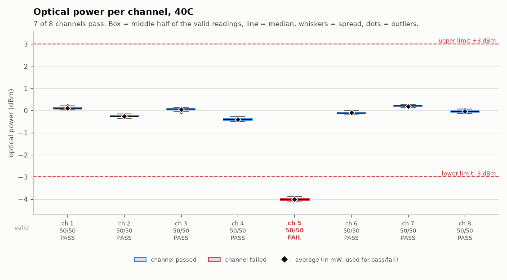
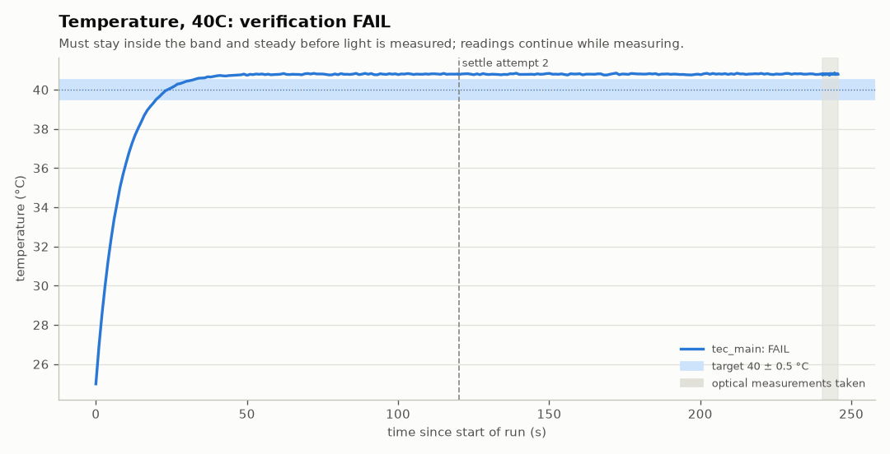

# Optical Module Test Automation (simulated instruments)

A modular Python system that tests an 8-channel optical module. It drives a temperature controller (TEC) and an optical power meter (OPM), takes the measurements, decides pass/fail, and saves raw data, a summary and charts for every run.

The instruments are **simulated** as separate network programs that speak a text command language, so the test software talks to them exactly as it would to real hardware.

| Document | What's in it |
|---|---|
| [docs/DESIGN.md](docs/DESIGN.md) | How it's built and why, including how to add a third instrument or a new test condition |
| [docs/TESTING.md](docs/TESTING.md) | How it was verified, including every error scenario |
| [sample_results/](sample_results/) | Six example runs: raw CSV, summary CSV, charts and logs |

---

## Quick start

Requires Python 3.11 or newer.

```bash
git clone https://github.com/Yas-Has/optical-module-test-automation.git
cd optical-module-test-automation
python3 -m venv .venv
source .venv/bin/activate
pip install ".[dev]"          # the program, charts and pytest (or: pip install . for the program only)

ate run                       # full test with the brief's settings
```

`ate` stands for **Automatic Test Equipment**. The command starts the simulated instruments in the background, runs the test, stops them, and prints a result table:

```
Condition 40C: temperature PASS [tec_main PASS 39.91 C]
   Ch  Meter:In    Avg dBm      Min      Max     Std Valid  Inv  T/O Garb  N/M Retry  Result
    1  opm_a:1       0.099   -0.016    0.228   0.054    50    0    0    0    0     0  PASS
   ...
OVERALL: PASS
```

Each run gets its own folder, `results/<date-time>_<serial>_<id>/`, so earlier runs are never overwritten.

### Commands

```bash
ate run --seed 42                       # replay a run exactly (every run saves its seed)
ate run --serial SN-1234                # set the device serial number
ate run --config config/examples/weak_channel.yaml
ate run --mode docker                   # simulators in a Docker container (see below)
ate validate --config my.yaml           # check a config without running anything
ate reprocess results/<run> --config strict.yaml   # re-judge saved data with new limits, without re-testing
ate plot results/<run>                  # draw the charts for a saved run
```

Exit codes: `0` device passed, `1` device failed, `2` run aborted or invalid input.

### Running in Docker (optional)

A normal `ate run` never uses Docker, and Docker isn't needed for anything else in this project. To run the simulators in a container instead, you first need Docker installed and running: [Docker Desktop](https://docs.docker.com/get-docker/) on macOS or Windows, or [Docker Engine](https://docs.docker.com/engine/install/) on Linux. Then build the image once and add `--mode docker`:

```bash
docker build -t optical-module-test-automation .   # once
ate run --mode docker
```

The test still runs from your computer, the results go to the usual folder, and the container is removed afterwards. The data is identical to a run without Docker.

---

## Changing the settings

Every number is in `config/default.yaml`, with a comment on each. The ones you're most likely to change:

| Setting | Default | What it does |
|---|---|---|
| `limits.avg_power_dbm` | `{min: -3.0, max: 3.0}` | Pass band for each channel's average (inclusive) |
| `limits.max_bad_readings` | `0` | Bad readings a channel may have and still pass |
| `sequence.conditions` | `[{setpoint_c: 40.0}]` | Temperatures to test at, in order |
| `sequence.temperature.tolerance_c` | `0.5` | How close to the setpoint counts as reached |
| `sequence.measurement.readings_per_channel` | `50` | Readings per channel |
| `instruments[].simulation.faults` | small rates | How often the simulators misbehave |
| `simulation.mode` | `network` | Where the simulators run: `network` (background program), `docker`, or `in_process` (inside the test program, used by the fast tests) |

The easiest way is a small file that changes only what you need:

```yaml
# my_limits.yaml
extends: config/default.yaml
limits:
  avg_power_dbm: { min: -1.0, max: 1.0 }
```

Then `ate run --config my_limits.yaml`. Mistakes are reported in plain language before anything runs. The summary and the charts follow the new settings.

**Example configs** in `config/examples/`: a weak channel, a flaky meter, a TEC that won't settle, two temperatures, and a 16-channel module read by two meters.

---

## How it works

```
config/*.yaml ─► Test runner ─► Drivers (TEC, OPM) ─► PyVISA ─► Simulated bench (separate program)
                     │                                          ├─ TEC simulator, OPM simulator
                     ▼                                          └─ shared virtual device
   raw_measurements.csv (written live) ─► analysis ─► summary.csv, charts
```

```
src/ate/
├── core/          the instrument contract, roles, transport, registry: knows no specific instrument
├── instruments/   one folder per instrument (tec/, opm/): command words, settings, driver, simulator
├── simulation/    the bench: shared virtual device, simulated clock, seeds, faults
├── sequence/      the test recipe: settle, verify, measure, retry, clean up
├── data/          raw recording, statistics, pass/fail, reports, charts
├── config.py      loads and validates the YAML
└── cli.py         the `ate` command
```

- **Instrument communication is separate from test execution.** The runner asks for "a temperature controller" and "a power meter" (roles). It never sees commands, sockets or a specific brand.
- **Adding an instrument means adding a folder.** The registry finds it automatically; nothing else is edited.
- **The same code drives real hardware.** Set `simulation.enabled: false` and enter real addresses.
- **Nothing is lost.** Every attempt at every reading is recorded with its status and the exact reply. Communication problems are retried once; impossible values are kept and never retried.
- **Every run is reproducible** from its saved seed, including every fault.

Details, including how to add a third instrument or a new test condition: [docs/DESIGN.md](docs/DESIGN.md).

---

## Results

| File | Contents |
|---|---|
| `raw_measurements.csv` | Every attempt at every reading: time, instrument, channel, index, attempt, value, unit, **status** (`VALID` / `INVALID` / `TIMEOUT` / `GARBLED` / `NOT_MEASURED`) and the exact raw reply |
| `summary.csv` | One row per channel per temperature: temperature verification, average/min/max/std, counts by status, channel result, overall result |
| `run_info.json` | Run ID, serial, seed, instruments, run status and overall result |
| `config_used.yaml`, `run.log`, `bench.log` | The exact settings used, and logs |
| `power_`, `temperature_`, `status_<condition>.png` | Charts (when matplotlib is installed) |

| Power per channel | Temperature | What happened to each reading |
|---|---|---|
|  |  |  |
| Weak channel: channel 5 is below the −3 dBm limit | TEC that won't settle: it levels off above the target band | Flaky meter: columns are lost messages re-asked; single squares are one channel re-read |

### Sample results

Six runs in [sample_results/](sample_results/), each with raw data, summary, charts and logs:

| Folder | Config | Seed | Result |
|---|---|---|---|
| `20261123-182555_SN-0001_904c` | default | 2 | PASS |
| `20261123-182555_SN-0001_b1d8` | default | 42 | FAIL: one impossible reading on channel 3 |
| `20261123-182557_SN-WEAK5_4b30` | weak_channel | 2 | FAIL: channel 5 averages −4.00 dBm |
| `20261123-182558_SN-FLAKY_b4d5` | flaky_meter | 2 | FAIL: many retries and re-reads, a few impossible readings |
| `20261123-182602_SN-HOT_f4b5` | tec_wont_settle | 2 | FAIL: temperature never verified; light still measured |
| `20261123-182603_SN-0001_5873` | two_temperatures | 2 | PASS at 25 °C and 40 °C |

Re-run any of them exactly with `ate run --config <its config_used.yaml> --seed <seed>`.

---

## Testing

```bash
pytest                    # 229 tests, about 10 seconds
pytest -m docker          # the Docker test (needs Docker running)
```

The `tests/` folder mirrors `src/ate/`, and every error scenario is forced on purpose rather than left to chance. Details and results: [docs/TESTING.md](docs/TESTING.md).

---

## Troubleshooting

- **"port(s) … are already in use"**: another simulator bench is still running. Stop it, or change `simulation.control_port` / `first_instrument_port`.
- **"Docker isn't installed" / "Docker isn't running" / "Docker image … not found"** (with `--mode docker`): install Docker (see [Running in Docker](#running-in-docker-optional)); start it (on Linux, `sudo systemctl start docker`, and your user may need to be in the `docker` group); or build the image with the command above. Nothing was created, so there's nothing to clean up.
- **"NumPy was built with baseline optimizations (X86_V2) but your machine doesn't support…"**: NumPy 2.4 and later need a processor from about 2009 onwards. Older machines, and virtual machines set to a basic CPU type such as `kvm64` or `qemu64`, don't qualify. Run `pip install "numpy<2.4"`, or set the VM's CPU type to `host`.
- **No charts** (the log says "Charts skipped"): run `pip install ".[plots]"`, then `ate plot results/<run>`.
- **`No module named 'ate'` after `pip install -e .` on macOS**: in an iCloud-synced folder, macOS can hide the file an editable install relies on. Use `pip install .` instead.

---

## AI assistance disclosure

AI assistance (Claude, by Anthropic) was used to discuss and refine the design, research existing Python instrument-simulation libraries, draft documentation, and write and review code and tests. All design decisions were discussed and made by the author, who reviewed, ran and tested the code.
