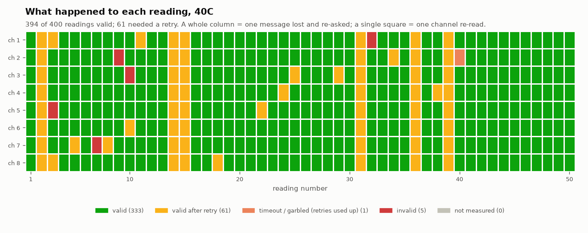

# Optical Module Test Automation (simulated instruments)

A modular Python system that tests an 8-channel optical module. It drives a temperature controller (TEC) and a multi-input optical power meter (OPM), takes the measurements, decides pass/fail, and saves raw data, a summary and charts for every run.

Physical instruments are not available, so they are **simulated**. The simulators are separate network programs that speak a text command language, so the test software talks to them exactly as it would to real hardware.

| Document | What's in it |
|---|---|
| [docs/DESIGN.md](docs/DESIGN.md) | Full design: understanding the data, architecture, error handling, extensibility |
| [docs/TESTING.md](docs/TESTING.md) | How the system was verified, including every error scenario |
| [sample_results/](sample_results/) | Six example runs (raw CSV, summary CSV, charts, logs). See [Sample results](#sample-results) |

---

## Quick start

Requires Python 3.11 or newer.

```bash
git clone https://github.com/Yas-Has/optical-module-test-automation.git
cd optical-module-test-automation
python3 -m venv .venv
source .venv/bin/activate
pip install ".[dev]"          # the program, charts (matplotlib) and pytest

ate run                       # full test with the default (brief) configuration
```

Other install options: `pip install .` (just the program, no charts) or `pip install ".[plots]"` (program and charts, no pytest).

`ate` stands for **Automatic Test Equipment**, the industry term for a computer driving instruments to test a product.

That one command starts the simulated bench in the background, runs the test, stops the bench, and prints a result table:

```
Condition 40C: temperature PASS [tec_main PASS 39.91 C]
   Ch  Meter:In    Avg dBm      Min      Max     Std Valid  Inv  T/O Garb  N/M Retry  Result
    1  opm_a:1       0.099   -0.016    0.228   0.054    50    0    0    0    0     0  PASS
   ...
OVERALL: PASS
```

Results go to `results/<date-time>_<serial>_<id>/`: raw data, summary, charts and logs. A new folder is created for every run, so earlier runs are never overwritten.

### Useful commands

```bash
ate run --seed 42                       # replay a run exactly (the seed is saved with every run)
ate run --serial SN-1234                # set the device serial number
ate run --mode in_process               # simulators inside the program (no network ports)
ate run --time-scale 1                  # real-time pacing (watch the temperature settle)
ate run --config config/examples/weak_channel.yaml

ate validate --config my.yaml           # check a config without running anything
ate reprocess results/<run-folder>      # re-analyse saved data without re-testing
ate reprocess results/<run> --config strict.yaml   # new limits -> new summary + charts, originals untouched
ate plot results/<run-folder>           # draw the charts for a saved run (e.g. one made before charts existed)

ate bench                               # start the simulators and leave them running...
ate run --external-bench                # ...then run tests against that bench from another terminal
```

Exit codes: `0` device passed, `1` device failed, `2` run aborted or invalid input.

### Example configurations

| Config | Shows |
|---|---|
| `config/default.yaml` | The brief: 40 °C ± 0.5, 50 readings × 8 channels, −3 to +3 dBm, all readings valid (`limits.max_bad_readings: 0`; raise it to allow a few bad readings per channel) |
| `examples/weak_channel.yaml` | Channel 5 is 4 dB dim. All readings valid, channel fails on average power |
| `examples/flaky_meter.yaml` | High fault rates. Retries, single-channel re-reads, invalid readings kept |
| `examples/tec_wont_settle.yaml` | TEC settles 0.8 °C too hot. Two settling attempts, verification fails, light still measured |
| `examples/two_temperatures.yaml` | A new test condition is config only: 25 °C then 40 °C |
| `examples/two_meters_16ch.yaml` | A 16-channel module read by two meters. Adding an instrument is config only |

Example configs use `extends: ../default.yaml` and override only what differs.

### Changing the settings

Every number the system uses is in `config/default.yaml`, with a comment on each. The ones you're most likely to change:

| Setting | Default | What it does |
|---|---|---|
| `limits.avg_power_dbm` | `{min: -3.0, max: 3.0}` | Pass band for each channel's average power (inclusive) |
| `limits.max_bad_readings` | `0` | Bad readings (invalid, timed out, garbled, not measured) a channel may have and still pass. Must be fewer than the readings taken |
| `limits.require_all_valid` | `true` | `false` accepts any number of bad readings |
| `sequence.conditions` | `[{setpoint_c: 40.0}]` | Temperatures to test at, in order |
| `sequence.temperature.tolerance_c` | `0.5` | How close to the setpoint counts as reached |
| `sequence.temperature.max_settle_attempts` | `2` | Settling attempts before temperature verification fails |
| `sequence.measurement.readings_per_channel` | `50` | Readings per channel per condition |
| `sequence.measurement.averaging_time_ms` | `100` | Meter averaging time (longer = steadier readings) |
| `instruments[].max_comm_retries` | `1` | Retries after a timeout or unreadable reply |
| `instruments[].simulation.faults` | small rates | How often the simulators misbehave (set to 0 for a perfect run) |
| `run.save_plots` | `true` | Draw charts at the end of each run |

The easiest way is a small file that changes only what you need:

```yaml
# my_limits.yaml
extends: config/default.yaml
limits:
  avg_power_dbm: { min: -1.0, max: 1.0 }
  max_bad_readings: 2
```

```bash
ate validate --config my_limits.yaml    # catches mistakes in plain language before anything runs
ate run --config my_limits.yaml
ate reprocess results/<run> --config my_limits.yaml   # or re-judge an existing run, without re-testing
```

The summary and the charts both follow the new settings. Tests in `tests/system/test_modified_settings.py` check this for each of the settings above.

### Running the tests

```bash
pytest                    # full suite (about 10 s)
pytest tests/instruments/tec          # just one part, e.g. the TEC
pytest -m "not slow"      # skip the 200-run statistical check
pytest -m "not network"   # skip tests that open local network ports
```

---

## How it works

```
config/*.yaml ──► Test runner ──► Drivers (TEC, OPM) ──► Transport ──► Simulated bench
                     │                                  (PyVISA)       (separate program)
                     ▼                                                  ├─ TEC simulator   :5101
              raw_measurements.csv  (written live, row by row)          ├─ OPM simulator   :5102
                     │                                                  ├─ control port    :5100
                     ▼                                                  └─ virtual device
              analysis ──► summary.csv, run_info.json, charts (.png)       (temperature + 8 lasers)
```

```
src/ate/
├── core/            shared machinery, knows no specific instrument
│   ├── instrument.py    the contract every instrument follows + how a reply is judged
│   ├── roles.py         what ANY temperature controller / power meter must be able to do
│   ├── settings.py      settings every instrument has (name, address, timeout, retries)
│   ├── transport.py     send a line of text, get a line back (PyVISA)
│   └── registry.py      finds every instrument folder automatically
├── instruments/     one folder per instrument, and nothing else
│   ├── tec/             commands.py · settings.py · driver.py · simulator.py
│   └── opm/             commands.py · settings.py · driver.py · simulator.py
├── simulation/      the bench as a whole: virtual device, clock, seeds, faults, ports
├── sequence/        the test recipe: settle, verify, measure, retry, clean up
├── data/            streaming raw recorder, statistics + pass/fail, reports, charts
├── config.py        loads + validates the YAML settings
└── cli.py           the `ate` command
```

| Layer | Responsibility | Knows about |
|---|---|---|
| `core/` | The instrument contract, roles, transport, registry | No specific instrument |
| `instruments/<name>/` | Everything about one instrument: command words, settings, driver, simulator | Only itself (and `core/`) |
| `simulation/` | The shared virtual device, simulated clock, faults, the bench program | No specific instrument |
| `sequence/` | The 8-step recipe and its policies | Roles only ("a temperature controller"), never a specific instrument |
| `data/` | Raw recording, analysis, reports, charts | Measurements only |

Key design points:

- **Separation of instrument communication and test execution.** The runner asks for "a temperature controller" and "a power meter" (roles) and calls `read_temperature()` / `read_all()`. It never sees commands, sockets, simulators or a specific brand.
- **One folder per instrument.** Everything about the TEC is in `instruments/tec/`; everything about the meter is in `instruments/opm/`.
- **Same code for simulated and real hardware.** Drivers use PyVISA. Setting `simulation.enabled: false` and entering real addresses is the only change needed.
- **Device link.** Both simulators share one virtual device, so temperature affects optical power (−0.1 dB/°C by default), just as in real lasers.
- **Errors recorded at the smallest level they affect.** A damaged channel is re-read alone, a lost message is re-asked, an impossible value is kept and never retried, and nothing is silently discarded.
- **Every run is reproducible** from its saved seed, including every fault, in both simulator modes.

See [docs/DESIGN.md](docs/DESIGN.md) for the full explanation.

---

## Output files (per run)

| File | Contents |
|---|---|
| `raw_measurements.csv` | Every attempt at every reading: timestamp, instrument, channel, meter input, index, attempt, value, unit, **status** (`VALID` / `INVALID` / `TIMEOUT` / `GARBLED` / `NOT_MEASURED`), and the exact raw reply |
| `summary.csv` | One row per channel per temperature condition: temperature verification, average/min/max/std, counts by status, retries, channel result, reasons, overall result |
| `run_info.json` | Run ID, serial, seed, instruments and their identities, status (`COMPLETE` / `COMPLETE_WITH_ERRORS` / `ABORTED` and why), overall result |
| `config_used.yaml` | The exact configuration of this run (re-run it with `--config`) |
| `run.log` | Human-readable log of everything that happened |
| `bench.log` | Simulator bench output (network mode) |
| `power_<condition>.png` | Box and whisker of each channel's valid readings, with the limits, the mW average used for pass/fail, and which channels failed |
| `temperature_<condition>.png` | TEC temperature over time against the target band, settling attempts, and when light was measured |
| `status_<condition>.png` | One square per planned reading, coloured by what happened: valid, valid after retry, timeout/garbled, invalid, not measured |

### Charts

| Power per channel | Temperature | What happened to each reading |
|---|---|---|
|  |  |  |
| Weak-channel run: channel 5 sits below the −3 dBm limit. The diamond is the average used for pass/fail | TEC-won't-settle run: the temperature levels off above the target band, through both settling attempts | Flaky-meter run: whole columns are lost messages re-asked; single squares are one channel re-read alone |

Charts are drawn at the end of every run when matplotlib is installed (`pip install ".[plots]"`; included in `.[dev]`). Turn them off with `run.save_plots: false`. Charts follow the config: limit lines, the target band, pass/fail colours and the number of readings all come from it. Re-checking a run against new limits (`ate reprocess --config`) draws a second set of charts with the same `_reprocessed_<time>` name as the new summary, leaving the originals alone. They are a convenience: if matplotlib is missing or a chart fails to draw, the run and its data are unaffected.

---

## Sample results

Six runs made over the real network bench, in [sample_results/](sample_results/). Each folder has the raw data, summary, charts and logs.

| Folder | Config | Seed | Result |
|---|---|---|---|
| `20261123-182555_SN-0001_904c` | default | 2 | PASS |
| `20261123-182555_SN-0001_b1d8` | default | 42 | FAIL: one impossible reading on channel 3 (kept, never retried) |
| `20261123-182557_SN-WEAK5_4b30` | weak_channel | 2 | FAIL: channel 5 averages −4.00 dBm |
| `20261123-182558_SN-FLAKY_b4d5` | flaky_meter | 2 | FAIL: many retries and re-reads, a few impossible readings |
| `20261123-182602_SN-HOT_f4b5` | tec_wont_settle | 2 | FAIL: temperature never verified; light still measured |
| `20261123-182603_SN-0001_5873` | two_temperatures | 2 | PASS at 25 °C and 40 °C |

Re-run any of them exactly with `ate run --config <its config_used.yaml> --seed <seed>`.

---

## Adding a third instrument or a new test condition

**Another instrument of an existing type** (e.g. a second power meter): add an entry to `instruments:` in the config. No code changes. See `examples/two_meters_16ch.yaml`.

**A different brand of an existing kind** (e.g. another company's power meter): copy `instruments/opm/` to `instruments/<new_meter>/` and change its four files: the command words, settings, driver (still a `PowerMeter`) and simulator. The registry finds the folder automatically. **Nothing outside the new folder changes**: the sequence, recorder, analysis and bench all work with it as-is.

**A new kind of instrument** (e.g. an optical switch in front of a single-input meter):
1. Create `instruments/switch/` with the same four files plus an `__init__.py` that declares `INSTRUMENT_TYPES`.
2. If it's a new *role*, add the role (what any switch must do) to `core/roles.py`.
3. Add the sequence step that uses it, and add it to the config.

Its tests go in `tests/instruments/switch/`, mirroring the code.

**A new test condition:**
- *Another temperature:* config only. Add an entry to `sequence.conditions` (see `examples/two_temperatures.yaml`).
- *A new kind of condition* (e.g. laser bias current): add the field to `Condition` and one step in the runner that applies it. Measurement and reporting are reused.

Details: [docs/DESIGN.md §14](docs/DESIGN.md#14-extensibility).

---

## Testing approach (summary)

223 automated tests, running in about 10 seconds (details and results in [docs/TESTING.md](docs/TESTING.md)). **The `tests/` folder mirrors `src/ate/`**: each part is tested next to where it lives, and only `tests/system/` tests the whole program together.

| Tests | Check |
|---|---|
| `tests/core/` | How replies are judged, the shared instrument lifecycle, roles, the registry (including a brand-new instrument folder being picked up automatically), PyVISA over a real socket |
| `tests/instruments/tec/`, `opm/` | Each driver's commands and reply handling; each simulator against its physics model |
| `tests/simulation/` | The device link, fault injection, simulated clock and seeds, the bench's control commands |
| `tests/sequence/` | The stability rule, the retry policy (each fault forced on purpose) |
| `tests/data/` | dBm/mW math, statistics, inclusive limits, live recording, reports, re-processing, charts |
| `tests/config/` | Every validation rule |
| `tests/system/` | Full runs, runs with changed settings (results and charts follow the YAML), failure scenarios (meter/TEC lost, Ctrl+C), network mode, CLI, and 200 seeded runs giving a 63% pass rate against the predicted 66% |

---

## Troubleshooting

- **"port(s) … are already in use"**: a simulator bench is still running (maybe from `ate bench`). Stop it with Ctrl+C in its terminal, use `ate run --external-bench`, or change `simulation.control_port` / `first_instrument_port`.
- **No charts in the results folder** (the log says "Charts skipped"): matplotlib isn't installed. Run `pip install ".[plots]"`, then `ate plot results/<run>` to draw charts for runs already made.
- **`ModuleNotFoundError: No module named 'ate'` after `pip install -e .` on macOS**: if the project is in an iCloud-synced folder (Desktop/Documents), macOS can mark the editable-install path file as hidden, and Python 3.13 ignores hidden path files. Use `pip install .` (non-editable) instead. The test suite reads straight from `src/`, so tests always use the working copy.

---

## AI assistance disclosure

AI assistance (Claude, by Anthropic) was used to discuss and refine the design, research existing Python instrument-simulation libraries, draft documentation, and write and review code and tests. All design decisions were discussed and made by the author, who reviewed, ran and tested the code.
